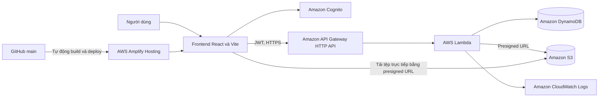

# UniCloud DMS: Tổng quan dự án

## 1. Giới thiệu

UniCloud DMS là ứng dụng quản lý tài liệu trên nền tảng web. Người dùng có thể đăng ký, đăng nhập, tải tài liệu lên, tìm và xem danh sách tài liệu, tải tệp xuống, đánh dấu yêu thích, chuyển tài liệu vào thùng rác, khôi phục, chỉnh sửa metadata và chia sẻ tài liệu với tài khoản khác.

Dự án ban đầu có giao diện React chạy cục bộ. Phần backend serverless được xây dựng bằng AWS SAM và kết nối với frontend; frontend được triển khai bằng AWS Amplify Hosting.

## 2. Kiến trúc hệ thống



### Các dịch vụ AWS

| Dịch vụ | Vai trò trong dự án |
|---|---|
| Amazon Cognito User Pool | Đăng ký, xác nhận tài khoản và đăng nhập người dùng; cấp token cho frontend. |
| Amazon API Gateway HTTP API | Nhận các yêu cầu REST từ frontend và chuyển đến Lambda. |
| AWS Lambda | Xử lý API, kiểm tra quyền, tạo presigned URL và thao tác metadata. |
| Amazon DynamoDB | Lưu metadata tài liệu, trạng thái yêu thích và thông tin chia sẻ. |
| Amazon S3 | Lưu nội dung tệp; frontend tải lên và tải xuống qua URL có chữ ký tạm thời. |
| Amazon CloudWatch | Thu thập log thực thi Lambda và hỗ trợ theo dõi lỗi. |
| AWS Amplify Hosting | Build và host frontend; kết nối GitHub để tự động triển khai khi cập nhật nhánh. |
| AWS SAM và CloudFormation | Khai báo, build và triển khai hạ tầng serverless từ mã nguồn. |

## 3. Tài nguyên và cấu hình đã triển khai

- Region: `ap-southeast-1` (Asia Pacific, Singapore).
- AWS SAM/CloudFormation stack đã dùng: `dms-dev` (đã cleanup ngày 19/11/2026).
- DynamoDB tables: `dms-dev-documents`, `dms-dev-favorites`, `dms-dev-shares`.
- S3 bucket: bucket tài liệu được SAM tạo tự động; tên thực tế được xuất ra trong CloudFormation outputs và cấu hình Amplify.
- Frontend hosting đã dùng: AWS Amplify, nhánh `main` của repository GitHub `Myers-Vertias/serverless-document-management` (app đã được xóa trong cleanup ngày 19/11/2026).
- Build frontend: `npm run build`; thư mục đầu ra: `dist`.
- Hosting URL của lần triển khai trước: [https://main.d3thpxpsfsv5yu.amplifyapp.com](https://main.d3thpxpsfsv5yu.amplifyapp.com). URL không còn là môi trường hoạt động sau cleanup.
- Frontend nhận các cấu hình môi trường `VITE_AWS_REGION`, `VITE_COGNITO_USER_POOL_ID`, `VITE_COGNITO_USER_POOL_CLIENT_ID`, `VITE_API_BASE_URL` và `VITE_S3_BUCKET_NAME` từ Amplify.

Không đưa mật khẩu, access key, session token, mã xác nhận, presigned URL hoặc thông tin đăng nhập vào tài liệu hay Git. Các giá trị định danh môi trường nên được lấy từ CloudFormation outputs/AWS Console thay vì chép bí mật vào mã nguồn.

## 4. Những bước đã thực hiện

1. Kiểm tra frontend React/Vite hiện có và xác định dữ liệu ban đầu còn dùng mock/localStorage.
2. Cài AWS CLI và AWS SAM CLI; xác thực AWS CLI bằng profile `dms-dev` ở region Singapore. Danh tính CLI đã được xác nhận bằng STS trong lúc thiết lập.
3. Tạo IAM group và người dùng phát triển, gán quyền cần thiết cho quy trình triển khai. Tạo IAM execution role cho Lambda và quyền truy cập runtime theo phạm vi dự án.
4. Tạo AWS Budget hàng tháng trị giá 10 USD với cảnh báo khi chi phí thực tế đạt 85%, 100% hoặc dự báo đạt 100%. Budget chỉ gửi cảnh báo, không tự giới hạn hay dừng tài nguyên.
5. Chuẩn bị backend bằng AWS SAM. `sam validate --lint` xác nhận template hợp lệ và `sam build` hoàn tất thành công.
6. Triển khai stack `dms-dev` thành công tại `ap-southeast-1`. Các tài nguyên bao gồm API, Lambda, Cognito, bucket S3 và ba bảng DynamoDB nêu trên.
7. Gọi endpoint health của API và nhận phản hồi `{"status":"ok","service":"dms-api"}`.
8. Khắc phục cấu hình CORS cho API/S3 và vấn đề header trong yêu cầu tải lên có chữ ký. Sau đó xác nhận tải tệp lên S3 thành công.
9. Kết nối GitHub với AWS Amplify, cấu hình lệnh build, thư mục `dist` và các biến môi trường; nhánh `main` được build/deploy thành công.
10. Kiểm tra thủ công ứng dụng đã host: đăng ký/đăng nhập, upload, xem danh sách, tải xuống, yêu thích, đưa vào thùng rác, khôi phục, chỉnh sửa metadata và chia sẻ tài liệu sang tài khoản khác. Tài khoản nhận thấy tài liệu trong mục chia sẻ và tải được tệp.

## 5. Kết quả kiểm tra thủ công

| Hạng mục | Kết quả ghi nhận |
|---|---|
| Cognito signup/login | Đã đăng ký và đăng nhập được bằng tài khoản thử nghiệm. |
| Upload | Tệp mẫu được tải lên; đã thấy object trong S3 và metadata trong DynamoDB. |
| Danh sách và tải xuống | Tài liệu xuất hiện trong giao diện; trình duyệt xác nhận tệp đã tải xuống. |
| Favorites | Đã đánh dấu yêu thích. Đây là trạng thái riêng theo người dùng, không chia sẻ giữa các tài khoản. |
| Trash/restore | Đã chuyển tài liệu vào thùng rác và khôi phục thành công. |
| Chia sẻ | Tài liệu xuất hiện trong mục “Được chia sẻ với tôi” của tài khoản nhận; tải xuống thành công. |
| Metadata | Đã lưu thay đổi metadata và thấy nội dung cập nhật trên trang chi tiết. |
| Health endpoint | Trả về trạng thái `ok` cho dịch vụ `dms-api`. |
| Kiểm tra quyền API | Request thiếu token trả `401`; tài khoản khác không thể đọc tài liệu chưa chia sẻ và nhận `404`. Chi tiết và ảnh minh chứng nằm trong báo cáo workshop, mục 5.7.2 và 5.10.2. |
| Giới hạn upload | API đã từ chối request đã xác thực khai báo kích thước `20 MiB + 1 byte` với HTTP `400`; ảnh nằm trong báo cáo workshop, mục 5.10.1. |

Các kết quả trên là kiểm tra thủ công qua giao diện và AWS Console, không phải báo cáo kiểm thử tự động.

## 6. Chạy dự án và triển khai

### Frontend local

Mở PowerShell tại thư mục gốc dự án:

```powershell
npm install
npm run dev -- --host 127.0.0.1 --port 5174
```

Mở URL Vite in ra trong terminal. Nếu cổng 5174 đã được dùng, Vite có thể tự chọn cổng kế tiếp, chẳng hạn 5175.

### Backend với AWS SAM

Mở PowerShell trong thư mục `backend`:

```powershell
sam validate --lint
sam build
sam deploy --guided --profile dms-dev --region ap-southeast-1
```

Khi deploy có thay đổi tài nguyên, xem changeset trước khi xác nhận. Chỉ cho phép SAM tạo IAM role nếu template và changeset đã được xem xét. Các outputs của stack cung cấp API URL, Cognito IDs, tên bucket và tên bảng.

### Frontend trên Amplify

Amplify theo dõi nhánh `main` của GitHub, chạy `npm run build` và publish thư mục `dist`. Khi đẩy commit mới lên nhánh này, Amplify có thể tự build và triển khai bản frontend mới.

## 7. Báo cáo workshop và minh chứng

Báo cáo workshop có bản tiếng Anh `_index.md` và tiếng Việt `_index.vi.md`. Các phần về kiến trúc, Cognito, DynamoDB, S3, IAM/Lambda, API Gateway, kiểm thử đầu-cuối, monitoring và cleanup đã được cập nhật song ngữ.

Ảnh minh chứng được lưu trong `static/images/5-Workshop/` của repository báo cáo. Ảnh cleanup ở mục 5.12.2 ghi lại các thao tác thực tế và trạng thái hiển thị sau khi xóa tài nguyên, đồng thời được dùng làm hướng dẫn theo từng bước.

## 8. Việc còn lại

1. Đối chiếu lần cuối báo cáo với rubric nộp bài của trường.
2. Nếu cần chạy demo lại, triển khai lại AWS stack và Amplify từ mã nguồn sau khi xem kỹ changeset.
3. Theo dõi Billing kỳ tháng 11 sau khi dữ liệu được chốt; ảnh ngày 18/11 ghi trạng thái Pending tại thời điểm chụp.

## 9. Lưu ý về bảo mật và chi phí

- Không dùng root để triển khai hằng ngày; dùng IAM identity/profile có quyền phù hợp.
- Không commit thông tin bí mật hoặc tệp chứa credentials vào GitHub.
- Presigned URL là quyền truy cập tạm thời; không chia sẻ URL đó trong báo cáo hay ảnh chụp.
- AWS Budget gửi cảnh báo nhưng không tự dừng chi phí. Kiểm tra Billing thường xuyên và dọn tài nguyên không còn sử dụng sau khi hoàn tất workshop.
- Đây là môi trường đồ án/demo. Cần đánh giá lại chính sách IAM, xác thực, log, backup và xử lý dữ liệu trước khi dùng cho production.
