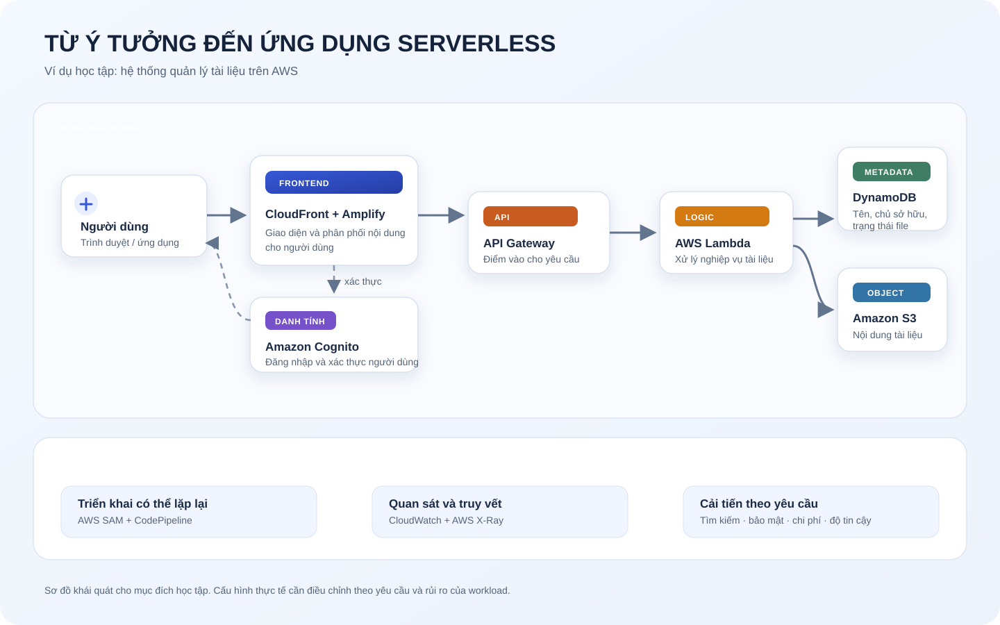

# Học AWS đừng chỉ học từng dịch vụ: hãy ghép chúng thành một sản phẩm

Có một cảm giác khá quen khi mới học cloud: mình biết S3 để lưu file, biết Lambda để chạy code, biết DynamoDB để lưu dữ liệu, rồi lại học thêm API Gateway, Cognito, CloudFront. Nhưng đến lúc được hỏi “vậy ghép chúng thành một ứng dụng chạy được như thế nào?”, các mảnh kiến thức ấy đôi khi vẫn nằm rời rạc.

Mình nghĩ đây là lúc nên đổi cách học: thay vì đi qua danh sách dịch vụ như học từ vựng, hãy chọn một sản phẩm nhỏ và nâng cấp nó từng bước.

## Một dự án đủ nhỏ để bắt đầu, đủ rộng để học nhiều thứ

Ví dụ, mình xây một hệ thống quản lý tài liệu. Người dùng đăng nhập, tải tài liệu lên, xem danh sách, tìm kiếm và tải file về. Nghe như một ứng dụng quen thuộc, nhưng phía sau nó là nhiều bài toán cloud thực tế:

- Frontend cần được triển khai và phân phối ổn định.
- Người dùng cần đăng nhập và được kiểm tra quyền.
- API cần tiếp nhận yêu cầu và gọi phần xử lý phù hợp.
- Thông tin tài liệu và nội dung file cần được lưu đúng nơi.
- Nhóm phát triển cần triển khai, theo dõi lỗi và cập nhật hệ thống.

Đây cũng là điểm mình thấy hay trong lộ trình Cloud Journey: tài liệu không chỉ dừng ở việc giới thiệu dịch vụ, mà còn có một chuỗi workshop về hệ thống quản lý tài liệu serverless, từ CRUD với Lambda và DynamoDB, tích hợp frontend với API Gateway, lưu trữ và xác thực, đến triển khai bằng SAM, phân phối nội dung, tìm kiếm, DevOps và theo dõi phân tán.

## Nhìn hệ thống như những ranh giới trách nhiệm

Khi ráp các phần lại, mình không bắt đầu bằng câu hỏi “dịch vụ AWS nào đang hot?”. Mình bắt đầu từ việc mỗi thành phần chịu trách nhiệm cho việc gì:

1. **Giao diện** hiển thị danh sách và biểu mẫu cho người dùng.
2. **Đăng nhập** xác định người dùng là ai.
3. **API** nhận yêu cầu và là ranh giới giữa giao diện với backend.
4. **Lambda** thực hiện nghiệp vụ, chẳng hạn tạo metadata hoặc cấp quyền truy cập file.
5. **DynamoDB** lưu metadata như tên file, chủ sở hữu và thời điểm tạo.
6. **S3** lưu nội dung file.
7. **CloudFront** phân phối nội dung; **CloudWatch và X-Ray** giúp quan sát hoạt động và lần theo lỗi.

Sơ đồ bên dưới là một cách hình dung kiến trúc học tập ở mức khái quát. Thiết kế thực tế còn phụ thuộc yêu cầu về quyền riêng tư, kích thước file, tải truy cập, chi phí và cách kiểm soát quyền truy cập vào từng tài liệu.

## Học theo từng phiên bản, thay vì cố dựng hệ thống lớn ngay từ đầu

Mình sẽ chia dự án thành các phiên bản nhỏ:

**Phiên bản 1: chạy được luồng cơ bản.** Tạo API thêm và đọc metadata tài liệu. Mục tiêu là hiểu request đi qua API đến Lambda và dữ liệu được lưu ở đâu.

**Phiên bản 2: thêm danh tính và file thật.** Bổ sung đăng nhập, quyền sở hữu tài liệu và lưu file trên object storage. Lúc này, mình cần phân biệt dữ liệu mô tả với nội dung file, đồng thời kiểm tra người dùng chỉ thao tác trên tài liệu họ được phép truy cập.

**Phiên bản 3: đưa ứng dụng đến gần môi trường thật.** Phân phối frontend, tự động hóa triển khai bằng Infrastructure as Code và thêm pipeline để thay đổi có thể lặp lại.

**Phiên bản 4: vận hành và cải tiến.** Theo dõi lỗi, độ trễ và các chỉ số quan trọng; thử tìm kiếm; xem lại chi phí, bảo mật và khả năng phục hồi. Mỗi lần thêm tính năng là một cơ hội để kiểm tra lại thiết kế.

Cách này giúp mình nhìn thấy lý do cần từng dịch vụ. Nếu một thành phần chưa giải quyết vấn đề nào của ứng dụng, có lẽ mình chưa cần thêm nó.

## Cloud journey không phải đường thẳng một chiều

Cloud Journey sắp xếp nội dung từ nền tảng AWS, dịch chuyển workload, tối ưu vận hành, hiện đại hóa ứng dụng, container, dữ liệu đến AI/ML. Có thể xem đây là bản đồ để định hướng, chứ không phải checklist bắt buộc phải hoàn thành theo đúng một thứ tự cho mọi người.

Khi làm một dự án, mình có thể quay lại phần nền tảng để chỉnh IAM, quay lại phần quan sát để bổ sung log, hoặc quay lại tối ưu khi biết workload thực sự sử dụng tài nguyên ra sao. Cách học theo vòng lặp này cũng gần với hướng dẫn của AWS Cloud Adoption Framework: hình dung kết quả cần đạt, chuẩn bị và căn chỉnh năng lực, thử nghiệm sáng kiến nhỏ, rồi mở rộng dựa trên điều đã học.

Và khi đánh giá một hệ thống, đừng chỉ hỏi “nó chạy chưa?”. AWS Well-Architected Framework nhắc đến sáu góc nhìn quan trọng: vận hành, bảo mật, độ tin cậy, hiệu quả hiệu năng, tối ưu chi phí và tính bền vững. Không phải dự án học tập nào cũng cần tối ưu cả sáu ngay lập tức, nhưng biết đặt câu hỏi sớm sẽ giúp mình tránh xem một bản demo là kiến trúc hoàn chỉnh.

## Điều mình rút ra

Học cloud hiệu quả không phải là nhớ thật nhiều tên dịch vụ. Mình cần hiểu yêu cầu, chia hệ thống thành các trách nhiệm rõ ràng, chọn dịch vụ phù hợp, rồi quan sát kết quả để tiếp tục điều chỉnh.

Một ứng dụng quản lý tài liệu nhỏ có thể trở thành chiếc khung để học API, serverless, cơ sở dữ liệu, lưu trữ, xác thực, triển khai và vận hành. Sau khi hiểu được cách các phần phối hợp, việc học thêm một dịch vụ mới sẽ dễ gắn với một vấn đề cụ thể hơn.

Nếu đang bắt đầu với AWS, hãy thử chọn một sản phẩm nhỏ mà mình hiểu rõ. Làm phiên bản đơn giản trước, viết lại sơ đồ, giải thích vì sao chọn từng thành phần, rồi mới thêm yêu cầu tiếp theo. Đó là lúc kiến thức cloud bắt đầu kết nối thành kỹ năng thiết kế hệ thống.

## Tài liệu tham khảo

- [Cloud Journey: Hành trình đầu tiên lên Mây](https://cloudjourney.awsfcaj.com/vi/)
- [Hiện đại hóa ứng dụng trên AWS](https://cloudjourney.awsfcaj.com/vi/4-modernize/)
- Chuỗi workshop Document Management System: [CRUD với Lambda và DynamoDB](https://000133.awsfcaj.com/vi/), [lưu trữ và xác thực với Amplify](https://000134.awsfcaj.com/vi/), [frontend với API Gateway](https://000135.awsfcaj.com/vi/), [triển khai với AWS SAM](https://000136.awsfcaj.com/vi/), [CloudFront](https://000137.awsfcaj.com/vi/), [tìm kiếm](https://000138.awsfcaj.com/vi/), [DevOps](https://000139.awsfcaj.com/vi/) và [X-Ray/CloudWatch](https://000140.awsfcaj.com/vi/)
- [Cloud Journey: FCJ Workforce Program](https://cloudjourney.awsfcaj.com/vi/8-fcjworkforce/)
- [AWS Cloud Adoption Framework: Your cloud transformation journey](https://docs.aws.amazon.com/whitepapers/latest/overview-aws-cloud-adoption-framework/your-cloud-transformation-journey.html)
- [AWS Well-Architected Framework: The pillars](https://docs.aws.amazon.com/wellarchitected/latest/framework/the-pillars-of-the-framework.html)
