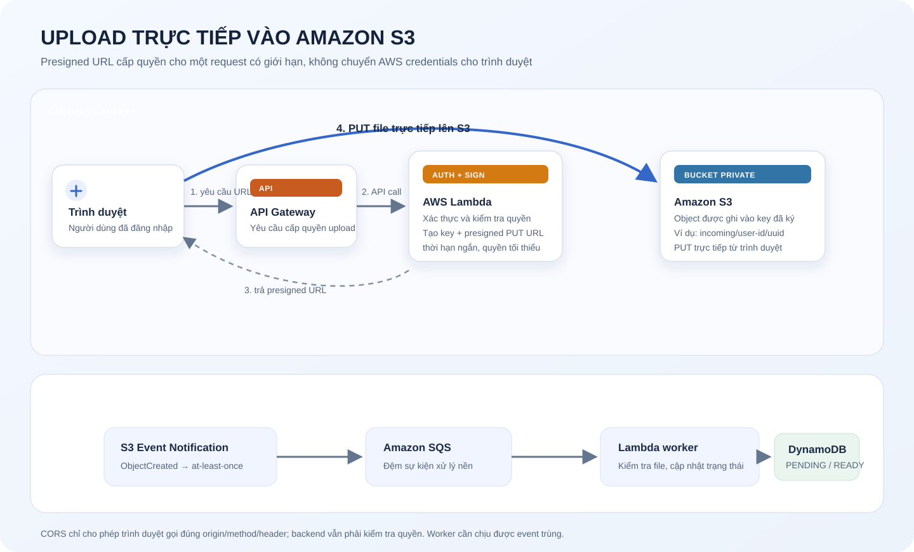

# S3 Presigned URL: tải file thẳng lên S3 có an toàn không?

Một tình huống khá quen khi xây dựng ứng dụng quản lý tài liệu: người dùng chọn một file, frontend gửi file lên backend, rồi Lambda lại chuyển file đó sang Amazon S3.

Luồng này có thể hoạt động, nhưng backend đang làm trạm trung chuyển cho toàn bộ dữ liệu. Có cách nào để người dùng tải file trực tiếp lên S3 mà không phải cấp AWS credentials cho trình duyệt không?

Một lựa chọn phổ biến là **presigned URL**. Nhưng URL này thực sự cấp quyền gì, và điều gì xảy ra nếu nó bị lộ hoặc được dùng lại?

## 01 | Presigned URL là gì?

Presigned URL là một HTTP request đến S3 đã được ký bằng credentials của một IAM principal. Ứng dụng có thể trao URL này cho một client để client thực hiện một thao tác cụ thể trong một khoảng thời gian giới hạn, chẳng hạn `PUT` để tải lên hoặc `GET` để tải xuống.

Client không cần có AWS access key. Quyền của request vẫn bị giới hạn bởi quyền của principal đã tạo URL. Vì vậy, presigned URL không phải một cơ chế phân quyền hoàn toàn mới; nó là cách trao quyền sử dụng tạm thời cho một request đã được ký. AWS mô tả presigned URL như một bearer token [1]: ai có URL thì có thể dùng request đó trong thời gian nó còn hiệu lực.

## 02 | Luồng tải file trực tiếp lên S3

Ví dụ với một ứng dụng quản lý tài liệu:

1. Người dùng đăng nhập và yêu cầu tải một tài liệu lên.
2. Backend xác thực người dùng, kiểm tra quyền nghiệp vụ và tự tạo object key, chẳng hạn `incoming/user-123/uuid.pdf`.
3. Backend dùng IAM role của mình tạo presigned URL cho đúng bucket, object key, HTTP method và thời hạn.
4. Backend trả URL cho trình duyệt.
5. Trình duyệt gửi file trực tiếp đến S3 bằng request `PUT`.
6. Sau khi S3 nhận object, một luồng xử lý tiếp theo có thể kiểm tra file và cập nhật trạng thái tài liệu.

Điểm cần giữ rõ: Lambda cấp quyền và điều phối, còn nội dung file đi thẳng từ trình duyệt đến S3. Bucket vẫn có thể giữ private; presigned URL chỉ cho phép request đã ký truy cập object tương ứng trong thời gian giới hạn.

## 03 | URL hết hạn chưa chắc đã dùng một lần

Đây là chỗ dễ bị bỏ qua khi thiết kế upload. Presigned URL có thể được dùng nhiều lần cho đến khi hết hạn. Nếu object cùng key đã tồn tại, một lần `PUT` khác có thể thay thế object đó.

Vì vậy, đừng để client tự quyết định key dùng chung như `uploads/report.pdf`. Backend nên tạo key không trùng cho mỗi lần upload, gắn key với người dùng hoặc bản ghi nghiệp vụ, và chỉ ký thao tác trên đúng key cần thiết.

Nếu cần giới hạn kích thước theo một khoảng cụ thể, hãy cân nhắc presigned POST với policy có điều kiện `content-length-range`. Đừng mặc định rằng một presigned PUT URL tự nó đã giới hạn được dung lượng file theo yêu cầu ứng dụng. POST policy của S3 hỗ trợ điều kiện này [3].

## 04 | Thời hạn URL và credentials ký URL

Presigned URL còn hiệu lực đến thời điểm hết hạn đã cấu hình, nhưng không thể sống lâu hơn credentials đã dùng để ký. Nếu backend ký bằng credentials tạm thời từ IAM role, URL có thể hết hạn khi role session hết hạn, kể cả khi thời hạn cấu hình dài hơn.

AWS CLI và SDK cho phép đặt thời hạn tối đa đến 7 ngày trong các điều kiện tương ứng, nhưng con số tối đa không phải cấu hình mặc định nên dùng cho mọi ứng dụng. Hãy chọn thời hạn đủ cho thao tác dự kiến, cân nhắc tốc độ mạng và khả năng người dùng phải thử lại. URL càng sống lâu thì khoảng thời gian để người khác sử dụng URL bị lộ càng dài.

## 05 | CORS không thay thế kiểm tra quyền

Khi frontend và bucket ở các origin khác nhau, trình duyệt có thể gửi preflight request. CORS của bucket cần cho phép đúng origin, method như `PUT`, và các request header mà ứng dụng thực sự sử dụng.

Nhưng CORS chỉ điều khiển cách trình duyệt cho phép JavaScript gọi tài nguyên khác origin. Nó không xác thực người dùng, không thay thế IAM hoặc bucket policy, và không ngăn một HTTP client khác sử dụng URL đã bị lộ. AWS cũng nêu ACL và policy tiếp tục có hiệu lực khi bật CORS [4].

Một lỗi thường gặp khác là `SignatureDoesNotMatch`: request upload phải khớp với những gì đã được ký, bao gồm HTTP method và các header liên quan. Ví dụ, nếu `Content-Type` được đưa vào lúc tạo URL, client cần gửi đúng giá trị đó khi `PUT`. Tài liệu upload của AWS liệt kê các bước kiểm tra lỗi này [2].

## 06 | Upload thành công chưa có nghĩa file đã an toàn

Presigned URL giúp chuyển file đến S3, nhưng không tự xác nhận file có đúng định dạng nghiệp vụ, có chứa mã độc hay người dùng có quyền xem nó sau này hay không.

Một thiết kế thường gặp là tải file vào prefix như `incoming/`, sau đó phát sự kiện để worker kiểm tra và chuyển trạng thái từ `PENDING` sang `READY` hoặc `REJECTED`. Phần tải xuống chỉ được cấp URL sau khi backend xác thực lại quyền của người dùng và trạng thái tài liệu.

Nếu dùng S3 Event Notifications cho xử lý sau upload, cần tính đến việc sự kiện được phân phối theo semantics at-least-once và có thể đến trễ. Consumer nên xử lý lặp an toàn, ví dụ dựa trên object key cùng version hoặc một định danh xử lý đã lưu. Cũng cần tránh để Lambda ghi file vào chính prefix đang kích hoạt nó, nếu không có thể tạo vòng lặp sự kiện. AWS lưu ý về phân phối sự kiện và nguy cơ vòng lặp [5].

Với dữ liệu cần kiểm tra tính toàn vẹn, SigV4 presigned upload hỗ trợ gửi checksum header để S3 so sánh checksum với nội dung nhận được. Checksum giúp phát hiện dữ liệu truyền không khớp; nó không thay thế bước kiểm tra nội dung file. S3 hỗ trợ nhiều thuật toán checksum [6].

## 07 | Checklist trước khi dùng trong production

① Backend đã xác thực danh tính và quyền trước khi cấp URL chưa?

② Object key do backend tạo và giới hạn vào đúng vùng lưu trữ của người dùng chưa?

③ Bucket có giữ private, IAM role có quyền tối thiểu và URL có thời hạn phù hợp chưa?

④ Đã tính đến URL bị lộ, upload lại cùng key, CORS, kiểm tra checksum và xử lý file sau upload chưa?

⑤ Nếu S3 phát lại một event, worker có tránh xử lý nghiệp vụ hai lần không?

## KẾT LUẬN

Presigned URL giúp trình duyệt tải file trực tiếp lên S3 mà không cần giữ AWS credentials và không phải chuyển toàn bộ nội dung qua Lambda. Đổi lại, URL cần được xem như một quyền truy cập tạm thời: ai sở hữu nó có thể thực hiện request đã ký cho đến khi URL hoặc credentials liên quan hết hiệu lực.

Một luồng an toàn vì thế không dừng ở bước “tạo URL”. Backend cần quyết định ai được upload, object key nào được phép dùng và trong bao lâu; hệ thống cũng cần kiểm tra file sau khi nhận và xử lý sự kiện theo cách chịu được retry.

**Presigned URL giúp chuyển giao một request có giới hạn. Quyền nghiệp vụ vẫn phải được kiểm soát ở ứng dụng.**

#AWS #AmazonWebServices #CloudComputing #CloudArchitecture #AmazonS3 #AWSLambda #Serverless #CloudSecurity #PresignedURL #AWSSecurity #AWSStudyGroupVN

## Nguồn tham khảo:

1. https://docs.aws.amazon.com/AmazonS3/latest/userguide/using-presigned-url.html
2. https://docs.aws.amazon.com/AmazonS3/latest/userguide/PresignedUrlUploadObject.html
3. https://docs.aws.amazon.com/AmazonS3/latest/developerguide/sigv4-HTTPPOSTConstructPolicy.html
4. https://docs.aws.amazon.com/AmazonS3/latest/userguide/cors.html
5. https://docs.aws.amazon.com/AmazonS3/latest/userguide/EventNotifications.html
6. https://docs.aws.amazon.com/AmazonS3/latest/userguide/checking-object-integrity-upload.html
